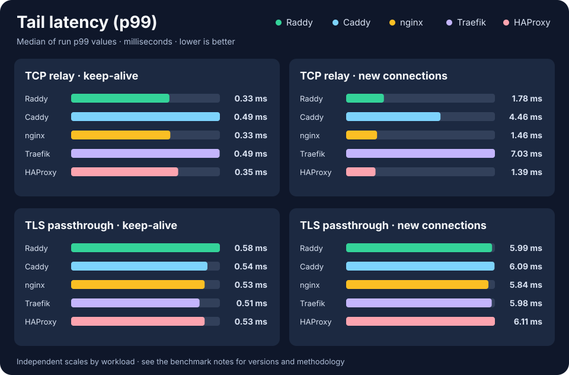

# TCP and TLS passthrough benchmarks

[Home](../README.md) · [HTTP/HTTPS reverse proxy](BENCHMARKS.proxy.md) · [Raw Layer 4 results](benchmarks/layer4-results.jsonl)

The proxies forward bytes; they do not act as HTTP servers in this test. The TLS passthrough listener selects an upstream by SNI, then forwards the untouched TLS session. TLS terminates at the same nginx origin for every proxy.




Each panel has its own scale and starts at zero. The throughput numbers are application requests per second, not connections per second or bulk throughput in Gbit/s.

| Workload | Raddy | Caddy + caddy-l4 | nginx stream | Traefik | HAProxy |
| --- | ---: | ---: | ---: | ---: | ---: |
| TCP relay, keep-alive | 147,346 · 0.33 ms | 126,037 · 0.49 ms | 150,814 · 0.33 ms | 126,556 · 0.49 ms | 139,953 · 0.35 ms |
| TCP relay, new connection per request | 27,884 · 1.78 ms | 15,318 · 4.46 ms | 34,660 · 1.46 ms | 11,483 · 7.03 ms | 33,498 · 1.39 ms |
| TLS passthrough, keep-alive | 90,484 · 0.58 ms | 93,369 · 0.54 ms | 92,659 · 0.53 ms | 92,586 · 0.51 ms | 92,273 · 0.53 ms |
| TLS passthrough, new connection per request | 1,723 · 5.99 ms | 1,708 · 6.09 ms | 1,738 · 5.84 ms | 1,717 · 5.98 ms | 1,738 · 6.11 ms |

Values are median requests per second and median p99 response latency. `wrk` reported no errors in 60 measured runs. nginx led the two TCP workloads, with Raddy about 2.3% behind nginx on TCP keep-alive. The spread between the highest and lowest median throughput was at most 3.2% in either TLS passthrough workload, where all proxies shared the same TLS origin.

## Method

- Raddy `v0.3.0` release binary, nginx `1.26.3` with the matching Debian `ngx_stream_module`, Traefik `3.7.19`, HAProxy `3.0.11-1+deb13u5`, and Caddy `2.11.4` with `caddy-l4 v0.1.2` (xcaddy `0.4.7`, Go `1.25.12`). The standard Caddy binary used for the HTTP comparison does not have the Layer 4 module.
- Debian 13 x86_64 with four QEMU vCPUs. The proxy, `wrk`, and nginx origin each ran on a separate vCPU. nginx and HAProxy used one worker thread; Raddy used `TOKIO_WORKER_THREADS=1`, and Caddy and Traefik used `GOMAXPROCS=1`.
- `wrk` sent HTTP/1.1 requests for a 1 KiB file through each proxy, with 32 concurrent connections and three eight-second runs after a two-second warm-up. Separate ports were used for raw TCP and TLS passthrough. PROXY protocol was not used.
- For TLS, the client sent SNI `localhost` and the origin used TLS 1.3 and an ECDSA P-256 certificate, without a session cache or tickets. Each proxy was checked for successful forwarding of that SNI and rejection of an unmatched name. Reconnect sends `Connection: close` on each request; throughput includes connection setup, but the `wrk` p99 column does not measure the full TCP/TLS handshake.

This loopback microbenchmark does not measure real Xray/VLESS sessions, bulk transfer bandwidth, or long-running tunnel capacity. The common origin and client can also limit the results.

## Reproduce it

Use the tools listed in the [HTTP/HTTPS proxy benchmark](BENCHMARKS.proxy.md#reproduce-it) and an nginx stream module matching the nginx binary. Build Caddy with [xcaddy](https://github.com/caddyserver/xcaddy):

```sh
xcaddy build v2.11.4 --with github.com/mholt/caddy-l4@v0.1.2 --output ./caddy-l4
mkdir -p target/benchmark-charts
python3 tests/benchmark.py target/release/raddy --layer4 \
  --caddy ./caddy-l4 --nginx /usr/sbin/nginx \
  --traefik /usr/bin/traefik --haproxy /usr/sbin/haproxy \
  --nginx-stream-module /usr/lib/nginx/modules/ngx_stream_module.so \
  > target/layer4-results.jsonl
python3 tests/benchmark_charts.py target/layer4-results.jsonl target/benchmark-charts --layer4
```
