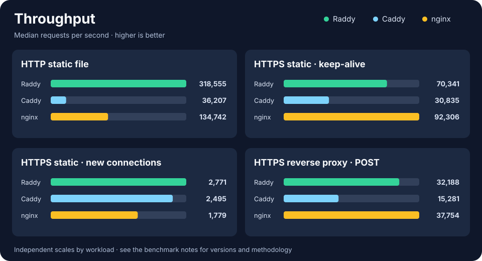
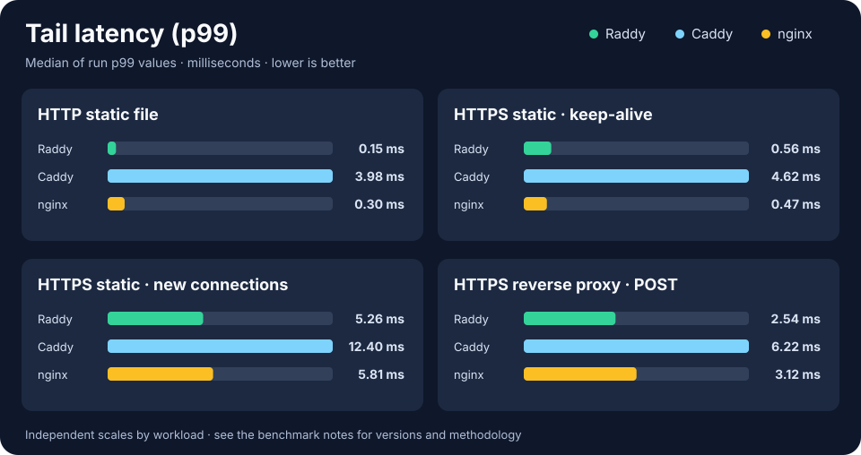

# Raddy, Caddy, and nginx benchmarks

[Home](../README.md) · [Five-server reverse proxy comparison](BENCHMARKS.proxy.md) · [TCP and TLS passthrough](BENCHMARKS.layer4.md) · [Raw results](benchmarks/results.jsonl) · [Benchmark script](../tests/benchmark.py)





Each panel starts at zero and has its own scale. Compare bar lengths within a panel, not across workloads. The labels show absolute values.

| Workload | Raddy | Caddy | nginx |
| --- | ---: | ---: | ---: |
| HTTP static file | 318,555 · 0.15 ms | 36,207 · 3.98 ms | 134,742 · 0.30 ms |
| HTTPS static, keep-alive | 70,341 · 0.56 ms | 30,835 · 4.62 ms | 92,306 · 0.47 ms |
| HTTPS static, new connections | 2,771 · 5.26 ms | 2,495 · 12.40 ms | 1,779 · 5.81 ms |
| HTTPS reverse proxy, POST | 32,188 · 2.54 ms | 15,281 · 6.22 ms | 37,754 · 3.12 ms |

Each cell shows requests per second and p99 response latency (both are medians across runs). `wrk` reported no errors in 36 comparable runs or the three extra PROXY v1 runs.

## How it was measured

- Raddy `v0.3.0` (published Linux amd64 binary, checked against the release SHA-256), Caddy `2.10.2`, nginx `1.26.3`, and `wrk` from Debian (`4.1.0-4+b1`).
- Debian 13 x86_64, Linux `6.12.101+deb13-cloud-amd64`, QEMU with four vCPUs. Server, load generator, and echo backend were pinned to separate vCPUs; one worker for nginx, `GOMAXPROCS=1` for Caddy, and `TOKIO_WORKER_THREADS=1` for Raddy.
- HTTP/1.1 over loopback, 32 connections, three eight-second runs after two seconds of warm-up per run. The static file and POST body were each 1 KiB. Access logging and response compression were not enabled. nginx used `sendfile` for static files.
- All servers used the same ECDSA P-256 certificate. Caddy and nginx listeners were restricted to TLS 1.3; Raddy used its default TLS settings. nginx session tickets and its TLS session cache were disabled; Caddy and Raddy used their defaults. The reconnect workload sends `Connection: close` on every request. Its throughput includes connection setup, but `wrk` p99 does not measure full TCP/TLS setup time. This workload is not an isolated TLS handshake benchmark.
- The POST test used the same HTTP/1.1 Python echo backend, with buffering disabled for nginx and immediate flushing for Caddy. The backend can affect the result. The raw data also includes an extra Raddy-only PROXY v1 run series, which is not included in the three-way charts.

This HTTP/HTTPS suite is a single-CPU, warm-cache microbenchmark. It does not measure bulk file transfers, HTTP/2, QUIC, VLESS/XHTTP, or thousands of long-lived sessions. The separate [Layer 4 suite](BENCHMARKS.layer4.md) covers TCP relay and SNI-routed TLS passthrough.

## Reproduce it

On Linux with at least three available CPUs, install Python 3, OpenSSL, `taskset`, `wrk`, Caddy, and nginx. Use a released Raddy binary or build one with `cargo build --locked --release`.

```sh
mkdir -p target/benchmark-charts
python3 tests/benchmark.py target/release/raddy \
  --caddy /usr/bin/caddy --nginx /usr/sbin/nginx > target/benchmark-results.jsonl
python3 tests/benchmark_charts.py target/benchmark-results.jsonl target/benchmark-charts
```

Use `--case tls-keepalive` for a shorter, single-workload run, or `--baseline /path/to/older/raddy` to include another Raddy build. The chart generator requires all four comparison workloads and refuses to chart a run with errors.
