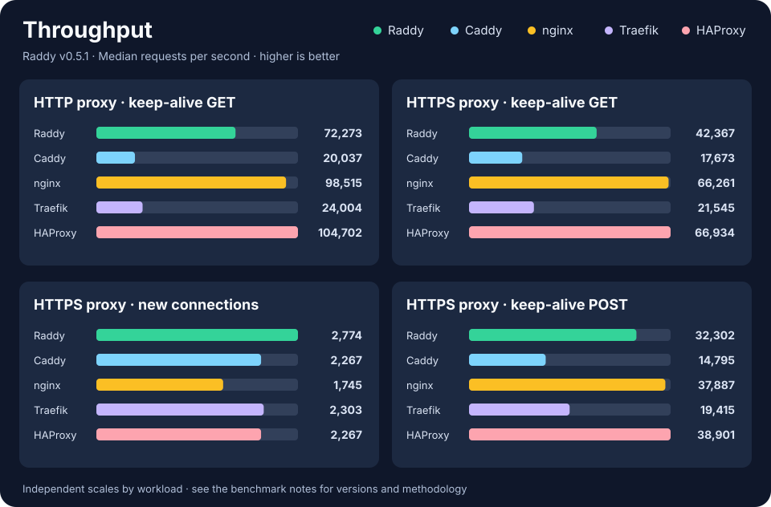

# HTTP and HTTPS reverse proxy benchmarks

[Home](../README.md) · [Native static file benchmarks](BENCHMARKS.md) · [TCP and TLS passthrough](BENCHMARKS.layer4.md) · [Raw results](benchmarks/http-relay-results.jsonl)

Raddy, Caddy, nginx, Traefik, and HAProxy all proxy to the same origin in this suite. It does not compare native file serving: Traefik and HAProxy are not general-purpose static file servers.




Each panel starts at zero and has its own scale. Compare bar lengths within a panel, not across workloads.

| Workload | Raddy | Caddy | nginx | Traefik | HAProxy |
| --- | ---: | ---: | ---: | ---: | ---: |
| HTTP GET, keep-alive | 72,273 · 0.68 ms | 20,037 · 5.22 ms | 98,515 · 0.53 ms | 24,004 · 6.66 ms | 104,702 · 0.49 ms |
| HTTPS GET, keep-alive | 42,367 · 1.10 ms | 17,673 · 5.72 ms | 66,261 · 0.76 ms | 21,545 · 6.94 ms | 66,934 · 0.74 ms |
| HTTPS GET, new connection per request | 2,774 · 5.08 ms | 2,267 · 15.08 ms | 1,745 · 6.79 ms | 2,303 · 15.56 ms | 2,267 · 9.26 ms |
| HTTPS POST, keep-alive | 32,302 · 2.61 ms | 14,795 · 6.18 ms | 37,887 · 2.81 ms | 19,415 · 6.42 ms | 38,901 · 2.41 ms |

Cells show median requests per second and median run p99 latency. `wrk` reported no errors in all 60 runs. HAProxy led throughput in the keep-alive workloads; Raddy led on HTTPS reconnect and was faster than Caddy and Traefik in every case. The chart measures the released Raddy `v0.5.1` binary.

The old [v0.3.0 results](https://github.com/rawtls/raddy/blob/v0.5.1/docs/benchmarks/http-relay-results.jsonl) showed 40.80 ms for HTTP keep-alive p99. In this 2026-11-24 run the three p99 values for Raddy v0.5.1 were 0.66, 0.72, and 0.68 ms. This is a release-to-release comparison, not a controlled single-change A/B.

## Method

- Raddy `v0.5.1` (Linux amd64 release), Caddy `2.10.2`, nginx `1.26.3-3+deb13u11`, Traefik `3.7.19`, and HAProxy `3.0.11-1+deb13u5`. Raddy and Traefik archives were verified against release SHA-256 checksums; nginx and HAProxy were extracted from Debian packages without installation.
- Debian 13 x86_64, Linux `6.12.101+deb13-cloud-amd64`, QEMU with four vCPUs. The proxy, `wrk` (`4.1.0-4+b1`), and backend were pinned to separate vCPUs. nginx and HAProxy used one worker thread; Caddy and Traefik used `GOMAXPROCS=1`, and Raddy used `TOKIO_WORKER_THREADS=1`.
- HTTP/1.1 on loopback, 32 connections, three eight-second runs per case after a two-second warm-up. The GET backend was a separate nginx instance serving a 1 KiB file; the POST backend was a Python HTTP/1.1 server echoing a 1 KiB body. Access logs and compression were off. None of the proxies served the file directly in this suite.
- HTTPS terminated at the proxy with the same ECDSA P-256 certificate. nginx, Caddy, Traefik, and HAProxy were set to TLS 1.3; Raddy used its defaults. nginx session tickets and session cache were disabled; the other proxies used their defaults. The reconnect test sends `Connection: close` on each request. Its throughput includes connection setup; `wrk` p99 does not measure the full TCP/TLS handshake.

These are results for the full request path in a single-CPU loopback test. The backend and load generator can limit performance. This does not measure real VLESS/XHTTP sessions, HTTP/2, or large transfers.

## Reproduce it

Use Python 3, OpenSSL, `taskset`, `wrk`, and the five proxies on Linux with at least three available CPUs. Build Raddy with `cargo build --locked --release` or use the published binary.

```sh
mkdir -p target/benchmark-charts
python3 tests/benchmark.py target/release/raddy --http-relay \
  --caddy /usr/bin/caddy --nginx /usr/sbin/nginx \
  --traefik /usr/bin/traefik --haproxy /usr/sbin/haproxy \
  > target/http-relay-results.jsonl
python3 tests/benchmark_charts.py target/http-relay-results.jsonl target/benchmark-charts
```
