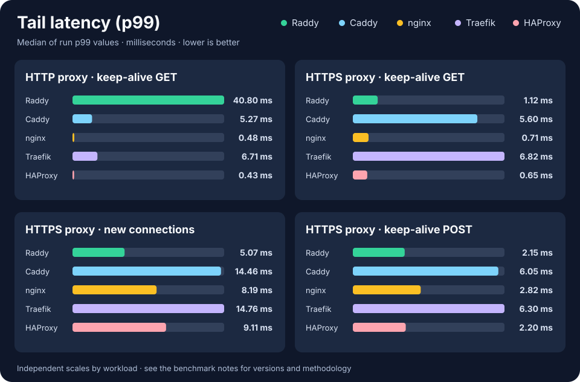

# HTTP and HTTPS reverse proxy benchmarks

[Home](../README.md) · [Native static file benchmarks](BENCHMARKS.md) · [TCP and TLS passthrough](BENCHMARKS.layer4.md) · [Raw results](benchmarks/http-relay-results.jsonl)

Raddy, Caddy, nginx, Traefik, and HAProxy all proxy to the same origin in this suite. It does not compare native file serving: Traefik and HAProxy are not general-purpose static file servers.




Each panel starts at zero and has its own scale. Compare bar lengths within a panel, not across workloads.

| Workload | Raddy | Caddy | nginx | Traefik | HAProxy |
| --- | ---: | ---: | ---: | ---: | ---: |
| HTTP GET, keep-alive | 66,432 · 40.80 ms | 20,178 · 5.27 ms | 100,148 · 0.48 ms | 23,955 · 6.71 ms | 105,624 · 0.43 ms |
| HTTPS GET, keep-alive | 41,125 · 1.12 ms | 18,331 · 5.60 ms | 67,245 · 0.71 ms | 22,075 · 6.82 ms | 68,509 · 0.65 ms |
| HTTPS GET, new connection per request | 2,746 · 5.07 ms | 2,317 · 14.46 ms | 1,764 · 8.19 ms | 2,383 · 14.76 ms | 2,312 · 9.11 ms |
| HTTPS POST, keep-alive | 33,079 · 2.15 ms | 15,584 · 6.05 ms | 38,251 · 2.82 ms | 20,174 · 6.30 ms | 40,014 · 2.20 ms |

Cells show median requests per second and median run p99 latency. `wrk` reported no errors in 60 runs. HAProxy led throughput in the three keep-alive workloads; Raddy led on HTTPS reconnect. The chart measures the released binaries. In a follow-up Raddy source A/B with the same workload (three five-second runs), changing only the plaintext listener to retain `TCP_NODELAY` reduced median run p99 from 39.82 ms to 0.70 ms. This change is not in the `v0.3.0` binary measured above.

## Method

- Raddy `v0.3.0` (Linux amd64 release), Caddy `2.10.2`, nginx `1.26.3`, Traefik `3.7.19`, and HAProxy `3.0.11-1+deb13u5`. The Raddy and Traefik archives were verified against the release checksums.
- Debian 13 x86_64, Linux `6.12.101+deb13-cloud-amd64`, QEMU with four vCPUs. The proxy, `wrk` (`4.1.0-4+b1`), and backend were pinned to separate vCPUs. nginx and HAProxy used one worker thread; Caddy and Traefik used `GOMAXPROCS=1`, and Raddy used `TOKIO_WORKER_THREADS=1`.
- HTTP/1.1 on loopback, 32 connections, three eight-second runs per case after a two-second warm-up. The GET backend was a separate nginx instance serving a 1 KiB file; the POST backend was a Python HTTP/1.1 server echoing a 1 KiB body. Access logs and compression were off. None of the proxies served the file directly in this suite.
- HTTPS terminated at the proxy with the same ECDSA P-256 certificate. nginx, Caddy, Traefik, and HAProxy were set to TLS 1.3; Raddy used its defaults. nginx session tickets and session cache were disabled; the other proxies used their defaults. The reconnect test sends `Connection: close` on each request. Its throughput includes connection setup; `wrk` p99 does not measure the full TCP/TLS handshake.

These are results for the full request path in a single-CPU loopback test. The backend and load generator can limit performance. This does not measure real VLESS/XHTTP sessions, HTTP/2, or large transfers.

## Reproduce it

Use Python 3, OpenSSL, `taskset`, `wrk`, and the five proxies on Linux with at least three available CPUs. Build Raddy with `cargo build --locked --release` or use the published binary.

```sh
mkdir -p target/benchmark-charts
python3 tests/benchmark.py target/release/raddy --http-relay \
  --caddy /usr/bin/caddy --nginx /usr/sbin/nginx \
  --traefik /usr/bin/traefik --haproxy /usr/sbin/haproxy \
  > target/http-relay-results.jsonl
python3 tests/benchmark_charts.py target/http-relay-results.jsonl target/benchmark-charts
```
